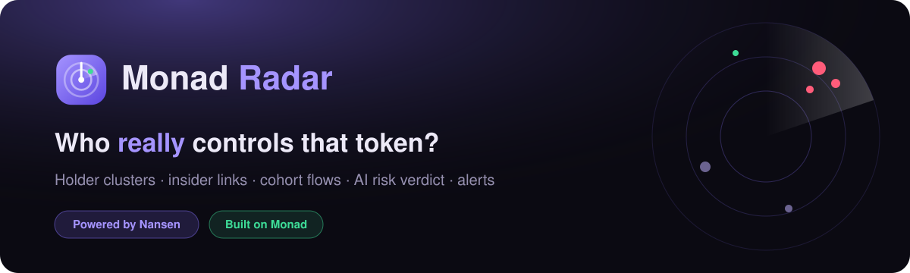
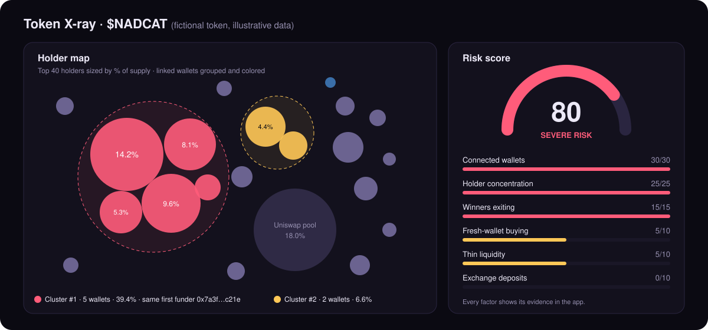
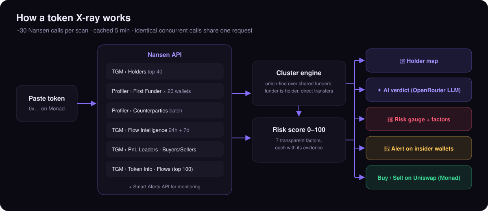

<p align="center">
  
</p>

<p align="center">
  <b>Paste any Monad token. See who really controls it, before you buy.</b><br/>
  Holder clusters · insider links · cohort flows · AI risk verdict · real-time alerts<br/>
  <sub>Built for <b>Monad Metropolis</b> · <b>Best use of Nansen</b></sub>
</p>

<p align="center">
  <a href="docs/monad-radar-demo.mp4"><b>▶ Watch the 2-minute demo video</b></a>
</p>

---

## The problem

Monad is new, fast and cheap, which also makes it a good place to launch a token, pump it and dump it. Retail buyers on Monad usually see four things: a chart, a market cap, a holder count and a Telegram group full of rocket emojis.

They don't see that the "40 independent holders" might be **5 wallets funded by the same address**. They don't see the early winners quietly leaving, or that most of the "buy pressure" comes from wallets created yesterday.

That information exists onchain, and Nansen has it. But it's spread across a dozen endpoints and needs an analyst to piece it together. **Monad Radar does that work in one scan and explains the result in plain English.**

> **Why not just show "smart money on Monad"?** We tried that first. On Monad today, Nansen's smart money labels are sparse: our live query returned only 2 smart money trades and empty net flows. A smart money dashboard would look empty. So we flipped the question. Instead of *"what are the experts doing?"*, Radar answers *"who is behind this token, and are they about to dump on me?"* That question has an answer for **every** Monad token, using Nansen's holder, funder, counterparty, flow and PnL data.

---

## A short story (illustrative)

> *This is a hypothetical scenario that shows the flow end to end. The token and numbers are fictional.*

**Tobi** has been on Monad for two weeks. One evening a token called **$NADCAT** is everywhere on their timeline: up 300% in a day, "community-owned", "40+ holders and growing". Tobi has 500 MON ready, and the buy button is one click away.

Out of habit, Tobi pastes the contract into **Monad Radar** first.

<p align="center">
  
</p>

Fifteen seconds later:

- **The holder map lights up red.** Five of the top holders sit in one cluster: **they were all first funded by the same wallet**, `0x7a3f…c21e`. Together they hold **39.4%** of the supply. The "community" is mostly one person.
- **Winners are exiting.** The top 10 profitable traders still hold only 12% of their peak positions. They've already sold.
- **Fresh wallets are doing the buying.** Most of the 24h inflow comes from brand-new wallets, a classic bot pattern used to fake demand.
- **The risk gauge reads 80, Severe.** The AI verdict sums it up: *"One connected group controls ~40% of supply while early profit-takers exit; buy pressure is driven by fresh wallets. Severe risk."*

Tobi doesn't buy. Instead they hit **🔔 Set alert → Insiders selling**, so Nansen watches those 5 linked wallets in real time and pings Tobi's Telegram the moment one of them sells.

Two days later the alert fires. The cluster dumps into the pool, and the chart drops 85% in an hour. Tobi still has their 500 MON.

**That's the product:** a scan that takes less time than reading the Telegram pinned message, with evidence a normal person can understand.

---

## What it does

| | Feature | What you see |
|---|---|---|
| 🫧 | **Holder map** | Bubble map of the top 40 holders, sized by share of supply. The top 20 are traced through Nansen: wallets with a **shared first funder**, wallets **funded by another top holder**, and wallets that **transact directly with each other** are merged into colored clusters, each with the reason it was linked. Pools, routers and exchanges are separated out so they don't count as "holders". |
| 🚨 | **Risk score (0–100)** | Seven transparent factors, each showing its evidence: holder concentration, connected wallets, fresh-wallet buying, exchange deposits, winners exiting, thin liquidity, top holders selling. |
| ✦ | **AI verdict** | An LLM analyst reads the whole X-ray and gives *Low / Moderate / High / Severe risk*, a one-line headline, 3–5 bullet points that cite the numbers, and what to watch next. |
| 🧭 | **Who's moving it** | Net flow by cohort over 24h and 7d: smart traders, top-PnL wallets, whales, public figures, fresh wallets and exchanges. Also the 24h biggest buyers and sellers, the 30d PnL leaderboard (with how much each winner still holds), and the 30-day balance trend of the top 100 holders. |
| 🔔 | **Alerts** | One click creates a **Nansen Smart Alert**: *Insiders selling* (watches the exact clustered wallets the X-ray found), *Large trades* or *Smart money flow*. Delivered to Telegram, Discord or a webhook. Manage them at `/alerts`. |
| 💱 | **Buy / Sell** | After the scan, buttons open **Uniswap on Monad** with the token preloaded (MON → token or token → MON), shown next to the risk level so the warning sits beside the button. |
| 🔥 | **Trending on Monad** | The home page lists the top Monad tokens by 24h volume from Nansen's Token Screener, each one click from an X-ray. |
| 🕵️ | **Wallet X-ray** | Click any bubble to see that wallet's labels, portfolio, 90-day PnL and win rate, best calls, recent trades and a clickable network graph of related wallets. |
| 💬 | **Ask Radar** | A tool-calling AI agent: *"Which trending Monad token looks riskiest right now?"* It chains `trending_tokens → token_xray` and answers with real numbers. Every Nansen tool call is shown on screen. |

---

## How it works

<p align="center">
  
</p>

1. **Collect.** About 30 Nansen calls run in parallel, capped at 5 at a time per wallet batch. Results are cached for 5 minutes, and identical concurrent requests (for example the page render and the AI route) share one call, so credits aren't spent twice.
2. **Cluster.** A union-find pass over the top 20 real holders joins wallets that share a first funder (shared *exchange* hot-wallet funders are ignored as weak evidence), wallets funded by another top holder, and wallets that are direct counterparties of each other.
3. **Score.** Seven deterministic factors produce the 0–100 score. They're computed in code, not by the LLM, so the score can be reproduced and every point traces back to Nansen data.
4. **Explain.** A compact version of the X-ray goes to the LLM (via OpenRouter), which must ground every claim in the numbers it's given and lower its conviction when data is thin.
5. **Act.** Buy or sell on Uniswap (Monad), or turn the found insider wallets into a live Nansen Smart Alert.

---

## Nansen integration

Every core feature is built on Nansen data; nothing is decorative. All calls go through `lib/nansen.ts` (`https://api.nansen.ai/api/v1`, `apikey` header).

| Nansen endpoint | Used for |
|---|---|
| `POST /tgm/holders` (`all_holders`, `smart_money`, `whale`) | Holder map, concentration, top holders selling |
| `POST /profiler/address/first-funder` | **Insider clustering**: shared funders, funder-is-holder |
| `POST /profiler/address/counterparties/batch` | **Insider clustering**: holders that transact with each other |
| `POST /tgm/flow-intelligence` (1d + 7d) | Cohort flows, fresh-wallet bot detection, exchange deposit pressure |
| `POST /tgm/pnl-leaderboard` | Who's winning, and whether the winners are exiting |
| `POST /tgm/who-bought-sold` (BUY + SELL) | Biggest buyers and sellers in 24h |
| `POST /tgm/flows` (`top_100_holders`) | 30-day top-holder balance trend |
| `POST /tgm/token-information` | Market cap, FDV, volume, buy share, liquidity, holder count |
| `POST /token-screener` | Trending Monad tokens on the home page; agent tool |
| `POST /smart-alert`, `GET /smart-alert/list`, `DELETE /smart-alert/{id}` | One-click alerts on insider wallets, large trades, smart money flows |
| `POST /profiler/address/labels`, `/current-balance`, `/pnl-summary`, `/related-wallets`, `/profiler/dex-trades` | Wallet X-ray and wallet network graph |
| `POST /smart-money/netflow`, `/dex-trades`, `/holdings` | Smart money page (`/smart-money`) and agent tool |

**AI agent tools** (`app/api/ask/route.ts`): `token_xray`, `trending_tokens`, `token_report`, `wallet_report`, `smart_money_overview`, `smart_money_trades`. Each one wraps several Nansen endpoints.

---

## How it matches the judging criteria

| Judges asked for | Monad Radar |
|---|---|
| Meaningfully integrate Nansen API / MCP / CLI | 20+ endpoints, including the **Smart Alerts write API**. Nansen data is combined into something no single endpoint returns: insider clusters. |
| Nansen as a core feature, not a superficial call | Remove Nansen and nothing is left. The map, score, verdict, alerts and agent all come from Nansen data. |
| Working product / demo | A working Next.js app (Radar, X-ray, Wallet X-ray, Ask Radar, Alerts) plus a demo video. |
| Explain how Nansen is integrated | The table above, plus every panel in the UI names its Nansen source. |
| Public repo / docs | This repository. |
| *"Make onchain intelligence more accessible, visual, actionable"* | **Accessible:** a plain-English verdict. **Visual:** the bubble map and gauge. **Actionable:** Buy/Sell next to the risk level, and an insider-selling alert. |

---

## Screenshots

<!--
  Add real screenshots after running a scan with credits:
  docs/screenshots/home.png, docs/screenshots/xray.png, docs/screenshots/alert.png, docs/screenshots/ask.png
  then replace this comment with:
  
-->

The images above are illustrations. **Demo video:** [`docs/monad-radar-demo.mp4`](docs/monad-radar-demo.mp4) (1:52, narrated; X-ray scenes use a fictional token with illustrative data).

---

## Run locally

```bash
git clone <this repo>
cd monad-radar
npm install
cp .env.example .env.local   # then add your keys
npm run dev                  # http://localhost:3000
```

`.env.local`:

```bash
NANSEN_API_KEY=...                               # https://app.nansen.ai
OPENROUTER_API_KEY=...                           # https://openrouter.ai
OPENROUTER_MODEL=anthropic/claude-sonnet-4.5     # any OpenRouter model with tool calling
```

**Stack:** Next.js 16 (App Router, Server Components, Partial Prerendering) · Tailwind CSS v4 · d3-hierarchy · Nansen API · OpenRouter.

## Project structure

```
lib/nansen.ts        Nansen client: typed endpoints, cache, in-flight dedupe
lib/xray.ts          X-ray engine: clustering, risk factors, AI payload
lib/ai.ts            OpenRouter chat + grounded JSON verdicts
app/page.tsx         Home: scan box + trending Monad tokens
app/token/[address]  Token X-ray
app/wallet/[address] Wallet X-ray
app/ask              Ask Radar agent
app/alerts           Manage Nansen Smart Alerts
app/api/*            insight · ask · alerts routes
```

## Roadmap

- Pay-per-scan with **x402 in USDC on Monad** (Nansen supports agentic payments on Monad), so anyone can scan without an API key.
- Deeper insider tracing: second-degree funders and deployer-cluster detection.
- Shareable X-ray cards for X/Telegram ("I checked before I aped").
- Watchlists: re-scan saved tokens every hour and alert when the risk score jumps.

---

<sub>Monad Radar shows what onchain data says. It is not financial advice. Clusters are heuristic: wallets that share a funder are not always the same person.</sub>
